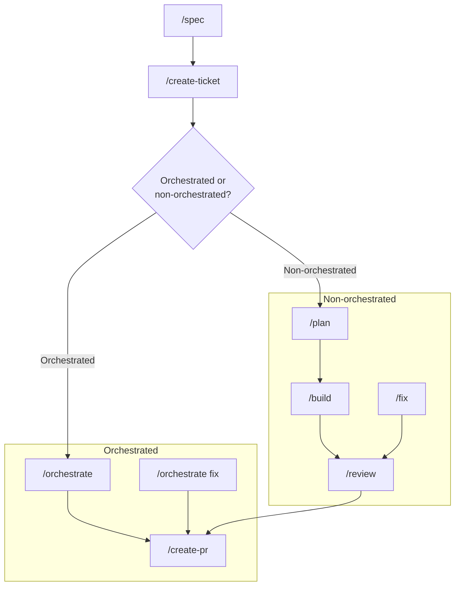
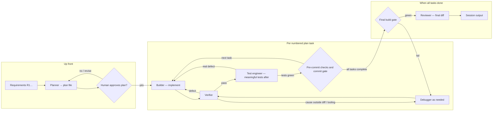

# Agentic development workflows

A project-agnostic Claude Code setup: **agents**, **commands**, **skills**, and **rules** for structured, multi-role development work.

## Adopting this in another repository

1. Copy `.claude/` and `CLAUDE.md` into the repository, leaving out `.claude/plans/`.
2. Rewrite **`.claude/rules/project.md`**: stack, commands, base branch, layout, tracker. Use `none` for anything the project lacks, and the workflow skips the steps that need it.
3. If your stack needs its own rules, add them as a stack add-on under `.claude/rules/`, and list it in `project.md` and `CLAUDE.md`.
4. Add `/.claude/plans/` to `.gitignore`.

Everything else reads its project-specific values from `project.md`. The placeholders `<test>`, `<lint>`, `<typecheck>`, `<build>`, `<e2e>`, and `<base-branch>` throughout the files refer to it.

## Workflow

End-to-end development starts with **`/spec`** → **`/create-ticket`**, then either an **orchestrated** or **non-orchestrated** path, and finishes with **`/create-pr`**. Run **`/research`** first when you don't yet know how to solve something. Smaller work can skip straight to `/plan` or `/fix`.

**Non-orchestrated:** **`/spec`** → **`/create-ticket`** → **`/plan`** → **`/build`** → **`/review`** → **`/create-pr`**. Follow-up work can re-enter the same tail as **`/fix`** → **`/review`** → **`/create-pr`**.

**Orchestrated:** **`/spec`** → **`/create-ticket`** → **`/orchestrate`** → **`/create-pr`**. Follow-up work can go **`/orchestrate fix`** → **`/create-pr`**.

**Non-orchestrated — you drive each step:** run the slash commands and supply the right context each time (ticket key, plan path, task number, and so on). For example: `/plan PROJ-123` → `/build plan1 1` → `/build plan1 2` → `/review` → `/create-pr`.

**Orchestrated — delegate the loop:** run **`/orchestrate`** (or **`/orchestrate fix`** for follow-up). You mainly **approve** at gates (plan approval, commit gate) or reply when the orchestrator asks; you still close out with **`/create-pr`**.

---

## Agents overview

| Agent                                        | `subagent_type`   | Purpose                                                                                                                  |
| -------------------------------------------- | ----------------- | ------------------------------------------------------------------------------------------------------------------------ |
| [Orchestrator](agents/orchestrator.md)       | `orchestrator`    | Coordinates plan → implement → verify → tests-after → review; enforces gates and artifact threading; does not edit tests. |
| [Planner](agents/planner.md)                 | `planner`         | Writes `.claude/plans/{slug}_plan.md` with numbered tasks, AC, and verification; no implementation unless asked.         |
| [Builder](agents/builder.md)                 | `builder`         | Production implementation from the plan; uses exact design values when a design source exists; no test sources in orchestrated runs. |
| [Test engineer](agents/test-engineer.md)     | `test-engineer`   | Owns unit, integration, and E2E test sources; writes meaningful tests after a slice is verified.                         |
| [Verifier](agents/verifier.md)               | `verifier`        | VerificationReport (criteria + optional browser sign-off); optional TestRequest flagging risk scenarios.                 |
| [Reviewer](agents/reviewer.md)               | `reviewer`        | Standards-first git diff review vs `rules/code-standards.md` (+ optional ticket AC).                                     |
| [Debugger](agents/debugger.md)               | `debugger`        | Systematic repro → root cause → fix → guard; defers test file edits to test-engineer under orchestrator rules.           |
| [Review resolver](agents/review-resolver.md) | `review-resolver` | Triages and resolves GitHub PR review threads.                                                                           |

---

## Orchestrator flow

The orchestrator keeps a **single source of truth**: requirements (**R1…**), the **active plan file**, and structured handoffs (**VerificationReport**, **TestRequest**). It must not impersonate specialists or edit test sources. For the full contract (gates, retries, routing, session output), read [agents/orchestrator.md](agents/orchestrator.md).

### Default order per plan task (tests-after)

| Step | Who             | Notes                                                                                                  |
| ---- | --------------- | ------------------------------------------------------------------------------------------------------ |
| 1    | `planner`       | Once per effort (or on revision); plan must include `## Task 1:`, `## Task 2:`, …                      |
| 2    | Human           | **Plan approval** before implementation                                                                |
| 3    | `builder`       | Production change for the task's acceptance criteria (keep the changed area compilable)                |
| 4    | `verifier`      | Structured report proving completed behavior; loop per routing if it fails                             |
| 5    | `test-engineer` | Meaningful tests after the slice passes (+ any TestRequest); must be green, or note none warranted     |
| 6    | `debugger`      | Escalation only: when the builder can't resolve a defect within its cap, or the cause is outside the diff |
| 7    | Human           | **Commit gate**: one commit per completed task, after the pre-commit checks in `project.md`            |

After **all** plan tasks are done, run the **Final build gate** once (`<build>`), then the **final diff review** against `origin/<base-branch>`.

### Bounded retries

| Loop / phase                                  | Suggested max |
| --------------------------------------------- | ------------: |
| Requirements clarification                    |             2 |
| Planner revision                              |             2 |
| Builder revision                              |             3 |
| Final build gate via debugger                 |             3 |
| Verifier re-check after fix                   |             2 |
| Test engineer per invocation                  |             2 |
| Debugger on same failure without new evidence |             2 |

---

## Test file ownership (orchestrator-led)

| Files                                            | Who may edit                                                   |
| ------------------------------------------------ | -------------------------------------------------------------- |
| Test file patterns in `project.md`, E2E specs    | `test-engineer` only (`verifier` when promoting a browser check) |
| Application code, non-test config per plan       | `builder`; `debugger` for tooling and production fixes         |

---

## Skills and rules

| Topic                                  | Location                                                                                 |
| -------------------------------------- | ---------------------------------------------------------------------------------------- |
| Project specifics                      | [rules/project.md](rules/project.md)                                                     |
| Code standards                         | [rules/code-standards.md](rules/code-standards.md)                                       |
| Design system and tokens               | [rules/design-system.md](rules/design-system.md)                                         |
| Testing principles                     | [rules/tests.md](rules/tests.md)                                                         |
| Commit conventions                     | [rules/commit-conventions.md](rules/commit-conventions.md)                               |
| Issue tracker conventions              | [rules/issue-tracker.md](rules/issue-tracker.md)                                         |
| RFC conventions                        | [rules/spec-docs.md](rules/spec-docs.md)                                                 |
| Plan template and checkpoints          | [skills/planning-and-task-breakdown/SKILL.md](skills/planning-and-task-breakdown/SKILL.md) |
| Implementation workflow                | [skills/implementation-workflow/SKILL.md](skills/implementation-workflow/SKILL.md)       |
| Unit tests                             | [skills/unit-testing/SKILL.md](skills/unit-testing/SKILL.md)                             |
| Integration tests                      | [skills/integration-testing/SKILL.md](skills/integration-testing/SKILL.md)               |
| Debugging process                      | [skills/debugging-and-error-recovery/SKILL.md](skills/debugging-and-error-recovery/SKILL.md) |
| Browser verification                   | [skills/browser-verification/SKILL.md](skills/browser-verification/SKILL.md)             |
| Figma design extraction (exact values) | [skills/figma-design-extraction/SKILL.md](skills/figma-design-extraction/SKILL.md)       |
| Spec and RFC workflow                  | [skills/spec-creation/SKILL.md](skills/spec-creation/SKILL.md)                           |
| Ticket drafting                        | [skills/ticket-creation/SKILL.md](skills/ticket-creation/SKILL.md)                       |
